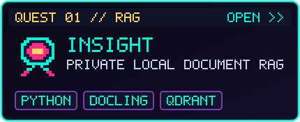
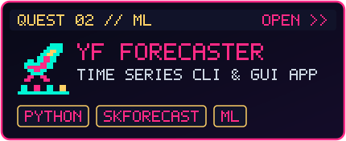

 

  

## `> PLAYER_LOG.md`

Welcome to my corner of GitHub! I'm **Cahyo Wisanggeni**, a **Statistics Student** who loves turning statistical theory, machine learning models, and local AI pipelines into practical tools.

- 📊 **Exploring:** Financial time-series forecasting, automated modeling workflows, and quantitative analysis.
- 🧠 **Building:** Privacy-first local **RAG** workspaces and **CLI / Desktop GUI** ML applications.
- 🎮 **Vibe:** Clean code, reproducible data pipelines, and retro neon arcade aesthetics.

  

  

## `> FEATURED_QUESTS`

  
  

 

| Quest | Focus | Tech Stack | Highlights |
| :--- | :--- | :--- | :--- |
| **[InSight](https://github.com/Cahyo-Wisanggeni/InSight)** | Private Document RAG | `Python` `FastAPI` `Docling` `Qdrant` `SQLite` `Ollama` | Local-first RAG workspace supporting PDF, Office docs, images & code with selectable full/quantized LLM inference |
| **[Yahoo-Finance-Forecaster](https://github.com/Cahyo-Wisanggeni/Yahoo-Finance-Forecaster)** | Financial Time Series | `Python` `skforecast` `Yahoo Finance` `CLI` `GUI` | Machine-learning forecasting platform for stocks, indices, commodities & crypto in both Terminal CLI and Desktop GUI |

  

## `> INVENTORY_&_TECH_STACK`

**Data, Statistics & ML**

**Local AI, Backend & Storage**

**Dev Environment**

  

## `> CONTRIBUTION_SNAKE`

  

 

  

